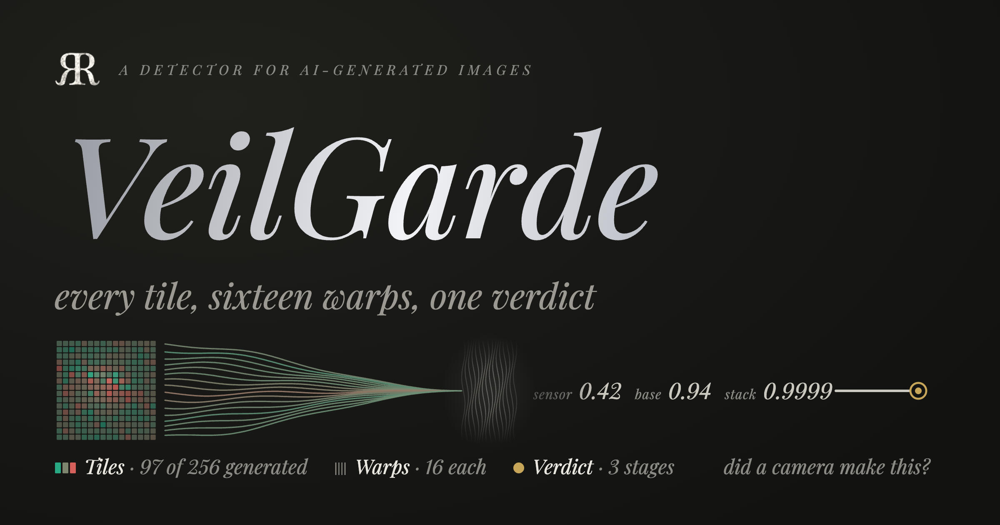

[](README_Assets/hero.png)

# VeilGarde

VeilGarde is a detector for AI-generated images, with a crop-robust watermark, as one Swift package you can train and run on a Mac. [Veil](https://veil.rao.nyc) is the pipeline, [Veil8](https://github.com/riteshpakala/Veil8) the PPM, VeilGarde the detection and watermarking.

It starts from one physical idea, the **warp lens**. Every 32×32 tile of an image is perspective-warped through 16 fixed homographies and back. A camera sensor's mosaic and noise do not survive the round trip the way a generator's output does, and the residual, with its seams, correlations and demosaic statistics, is scored tile by tile. That gives two calls: the **camera-sensor score**, whether a real camera made these pixels, and the **weighted verdict**, how generated the image looks where it matters.

Around the lens sit the models that made it robust: a fusion head over DINOv2 semantics and the capture signature, specialist heads for art, blur, faces, renders and screenshots, a stacked combiner, and a flywheel that keeps growing the heads without ever storing an image. A crop-robust signature is read off the same residual.

| Subpackage | Holds |
|---|---|
| `VeilGardeCore` | the domain, with no MLX: features, grids and the verdict law, the XGBoost codec, heads, bundles, the result JSON, the feature store |
| `VeilGardeLens` | the extractors: the warp residual and its 19 features, capture, DINOv2, CLIP, noiseprint |
| `VeilGardeInference` | the detector: the camera-sensor score, the fusion base, the specialist stack, the router, the verdict |
| `VeilGardeTraining` | the trainers for every shipped model, driven by a recipe DSL, and the backbone imports |
| `VeilGardeFlywheel` | acquisition into a features-only store, candidates, the battery, promote and rollback |
| `VeilWatermark` | a crop-robust signature read off the per-tile fragility pattern |
| `veilgarde` | the CLI over all of it |

## The CLI at a glance

```sh
scripts/cli.sh doctor                                   # builds veilgarde, installs MLX's Metal library, checks the setup
scripts/cli.sh score photo.jpg                          # the warp lens alone: camera-sensor score, weighted verdict
scripts/cli.sh route photo.jpg --json                   # the full detector, Garde's schema-v2 result
scripts/cli.sh train plan --preset ~/datasets/final_mixed  # what the shipped recipe would train, without training
VEILGARDE_CONFIG=release scripts/cli.sh train heads     # a candidate bundle under <work area>/candidates/
scripts/cli.sh flywheel init && scripts/cli.sh flywheel battery --gate full
VEILGARDE_CONFIG=release scripts/cli.sh research prune   # what the system could do without, measured on held-out data
scripts/cli.sh watermark sign photo.jpg > photo.vw1 && scripts/cli.sh watermark match crop.jpg photo.vw1
```

`scripts/cli.sh` builds `veilgarde`, installs `mlx.metallib` beside it, and finds Frigate. `scripts/cli.sh <command> --help` lists a command's flags.

## The playground

[Playground/](Playground/README.md) runs both regimes on this Mac in one program and exits 0 only when every checkpoint holds: one image through the lens, the camera-sensor score, the capture signature, the fusion base, the specialist stack and the combiner's arithmetic term by term, then each trainer in miniature, the flywheel's promote and rollback, and the watermark. [The site's chapter 9](docs/site/09-playground.html) walks through it.

```sh
Playground/run.sh
```

## VeilGarde docsite

A site that explains each layer and shows every file this build changed, verbatim, with each Swift declaration's calls and callers, and the run's ledger of commands, tests and decisions. Eleven trails walk the code in the order it runs: how the warp model, the fusion head, the specialist heads and the noiseprint are each trained, how each feeds the final verdict at inference, how the watermark signs an image and matches a crop of it, and the pruning study. A grid picks them, a row for each flow and a column for each kind. Double-click scripts/site.command, or open [docs/site/index.html](docs/site/index.html); it is plain HTML with no build step. [docs/site/README.md](docs/site/README.md) says how it is rebuilt and checked.

The site's chat asks Mistral about what you are reading. On a Mac that holds a Mistral key in its key store, `scripts/site.command` hands the site that key; anyone else is asked for their own key in a dialog when the chat opens, and it stays in their browser.

## Requirements and tests

- Xcode 27 (Swift 6.4), macOS 26, Apple silicon.
- [Frigate](https://github.com/rao-studios/Frigate), the family's MLX stack, checked out beside this repo or named by `VEILGARDE_FRIGATE_DIR`.
- A work area, the folder `VEILGARDE_WORK_AREA` (or `--work-area`) names: the live bundle, the weights, the feature store, candidates and the battery. VeilGarde writes nowhere else. Datasets live under `VEILGARDE_DATASETS`, else the work area's `datasets/`.
- The weights, in the work area's `weights/`: `veilgarde weights import-dinov2` builds DINOv2's from Hugging Face's checkpoint, and `veilgarde weights import-clip` CLIP's vision tower for acquisition. The noiseprint's weights, 130 KB, ship with the package.
- Tests: `swift build --build-tests`, then `./build-metallib.sh debug` to put MLX's Metal library into the test bundles, then `VEILGARDE_MLX_TESTS=1 swift test --skip-build --no-parallel` (without `VEILGARDE_MLX_TESTS`, only the CPU suites run). Before the next test build, delete the `mlx.metallib` copies inside `.build`'s `.xctest` bundles: a bundle that holds one fails to re-sign.

Inside each target, folders follow the order of operations. The site's chapters walk them, and its change explorer shows every file.

## Where it came from

VeilGarde consolidates the detector's research into one tool. Its inference reproduces Garde's, ([CLR](https://rao.nyc/thoughts/2026-04-25), [CLR (Journey)](https://paka.la/blog/clr-journey)), the R&D it supersedes; its trainers reproduce the research's Python recipes, whose numbers it quotes with their dates. It takes MLX from Frigate, and its layout, recipes, docs site and explorer from Braid.

GNU General Public License v3.0 (see [LICENSE](LICENSE)).
